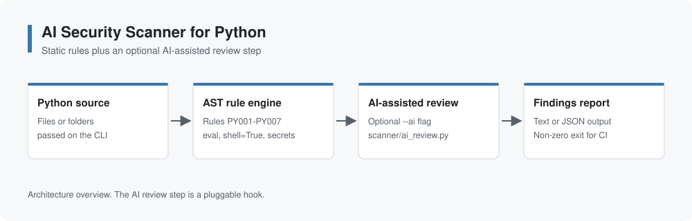
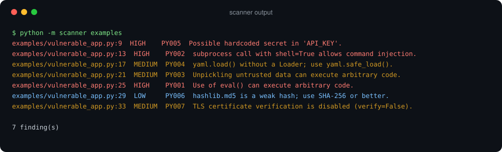

# AI Security Scanner for Python

Applied AI-assisted security scanning techniques to identify common application-security vulnerabilities in Python source code.



> **Status:** the scanner core (static rules, CLI, tests) works. The AI-assisted review step is a documented hook that is being extended.

## How it works

1. **Static rules:** the scanner parses each file with Python's `ast` module and flags risky patterns.
2. **AI-assisted review (optional):** `--ai` passes the code and the static findings to `scanner/ai_review.py`, where a language model can flag issues that pattern rules cannot see, such as missing authorization checks.
3. **Report:** findings are printed as text or JSON. The exit code is non-zero when anything is found, so the scanner can fail a CI pipeline.

| Rule | Severity | Detects |
| --- | --- | --- |
| PY001 | High | `eval()` / `exec()` |
| PY002 | High | `subprocess` with `shell=True` |
| PY003 | Medium | `pickle.load()` / `pickle.loads()` |
| PY004 | Medium | `yaml.load()` without a safe loader |
| PY005 | High | Hardcoded secrets (`password`, `token`, `api_key`, ...) |
| PY006 | Low | MD5 / SHA-1 hashing |
| PY007 | Medium | `requests` with `verify=False` |

## Example



## Usage

Requires Python 3.10+ and no third-party packages.

```bash
python -m scanner examples            # scan a folder or file
python -m scanner src --json          # JSON output
python -m scanner src --ai            # include the AI-assisted review step
python -m unittest                    # run the tests
```

## Repository structure

```text
scanner/
  rules.py          AST-based security rules
  ai_review.py      AI-assisted review hook
  __main__.py       command-line interface
tests/              unit tests for each rule
examples/           intentionally vulnerable sample code
docs/images/        diagrams and sample output
```

## Skills

`Python` `Static analysis` `Application security` `Secure code review` `AI-assisted tooling`

## Limitations

Pattern-based rules produce false positives and miss issues that span several functions. Treat findings as leads for manual review, not verdicts.
